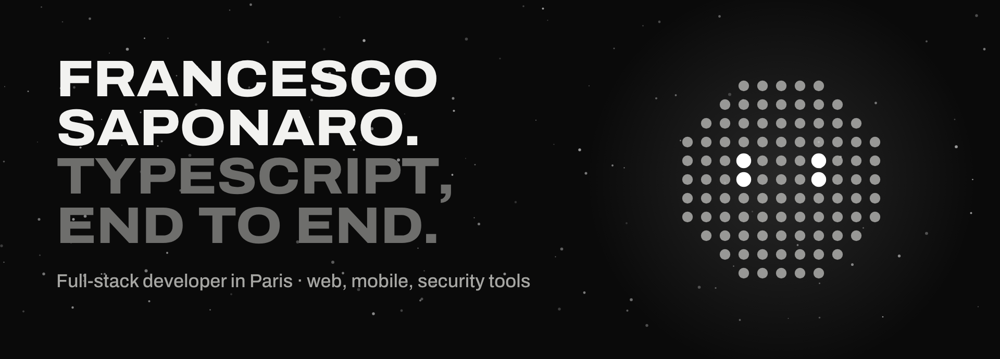
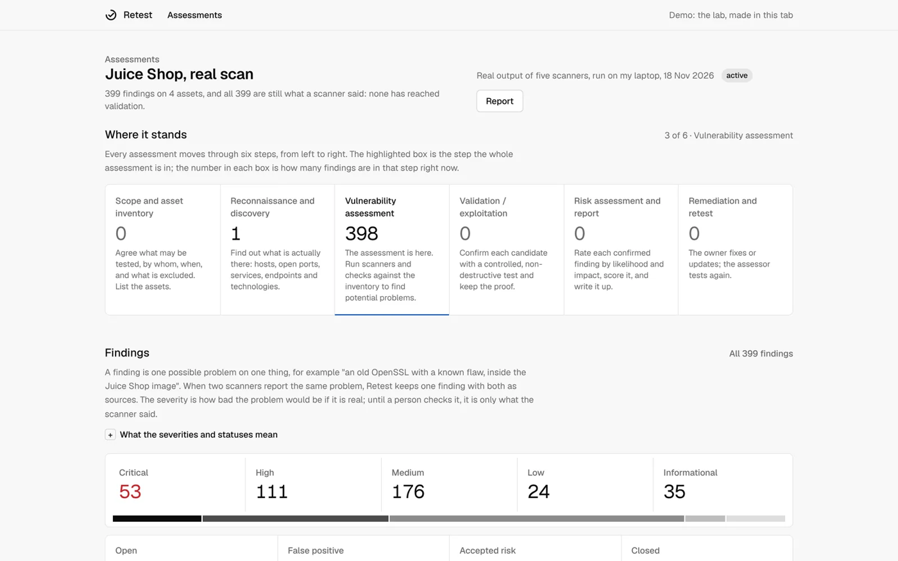
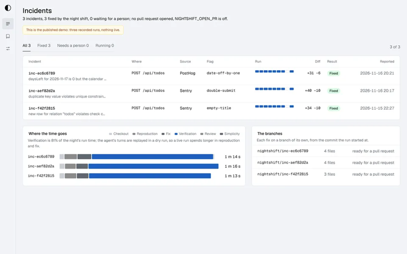
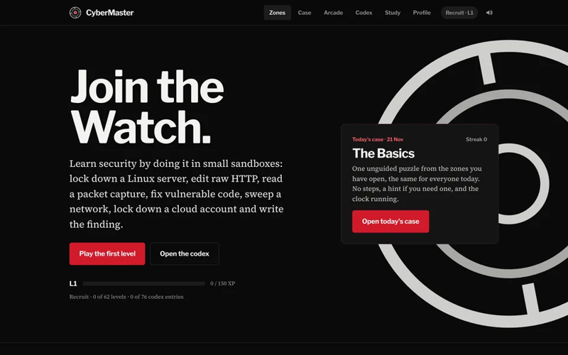
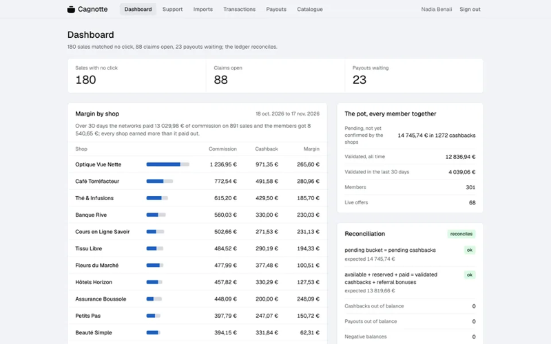
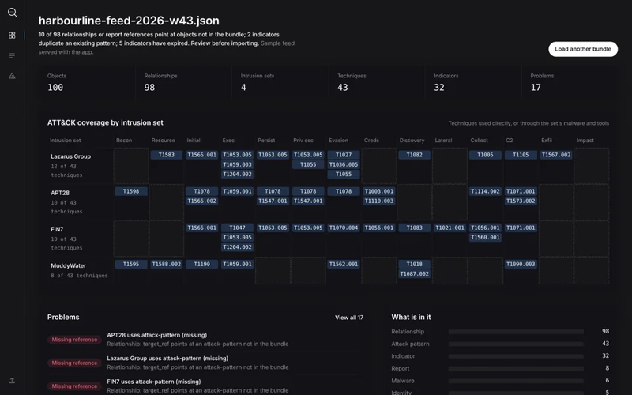
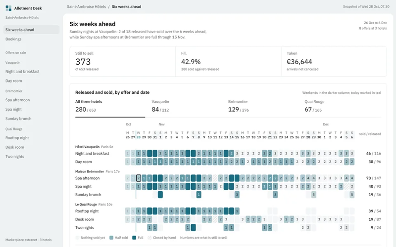

I build web and mobile products in TypeScript, from the data model to the last screen: React and Next.js in front, Node.js and PostgreSQL behind, Expo for mobile. I'm often the only developer on a product, so I own all of it: the schema, the API, the screens, the release.

At **Zumbat Hub** I rebuilt the company's flagship app from Flutter to Expo and shipped it on three stores, and I build Next.js front ends and Node.js back ends for e-commerce and planning products. Lately I've been building security tools too.

I work with coding agents: I write the spec and the tests, review every change, and own what ships.

## Retest

A workbench for security assessments. It reads the output of six scanners (Nmap, Nuclei, ZAP, Semgrep, Trivy, Prowler), merges what they agree on, recomputes every score with the official CVSS formula, and follows each finding from the first scan to a verified fix. The demo holds a real run against OWASP Juice Shop: 399 findings on 4 assets, and none counts as verified until a person has checked it.

TypeScript · Fastify · PostgreSQL · Drizzle · zod · React · TanStack

**[Live demo](https://retest-francesco-saponaro.netlify.app)** · **[Code](https://github.com/francesco-saponaro/retest)**

## Other projects

<table>
<tr>
<td width="50%" valign="top">

<h3>Nightshift</h3>

An on-call engineer that never sleeps. An error comes in, a reproduction is written, the fix is made in its own checkout, verified and reviewed, and a pull request opens.

TypeScript · Fastify · pg-boss · React

<a href="https://nightshift-francesco-saponaro.netlify.app">Live demo</a> · <a href="https://github.com/francesco-saponaro/nightshift">Code</a>

</td>
<td width="50%" valign="top">

<h3>CyberMaster</h3>

A browser game that teaches security by doing it: edit raw HTTP, read a packet capture, fix vulnerable code, sweep a network. Sixty-two levels in ten zones.

React · TanStack Router · Vite · zod

<a href="https://cybermaster-francesco-saponaro.netlify.app">Live demo</a> · <a href="https://github.com/francesco-saponaro/cybermaster">Code</a>

</td>
</tr>
<tr>
<td width="50%" valign="top">

<h3>Cagnotte</h3>

A cashback app and its back office. Affiliate files matched to the activations behind them, cashback by the offer's rules, and a double-entry ledger that reconciles to the cent.

Expo · Fastify · Drizzle · PostgreSQL

<a href="https://cagnotte-francesco-saponaro.netlify.app">Live demo</a> · <a href="https://github.com/francesco-saponaro/cagnotte">Code</a>

</td>
<td width="50%" valign="top">

<h3>STIX Lens</h3>

See what is inside a threat-intelligence bundle before you import it: the objects, the ATT&amp;CK techniques each intrusion set covers, and the references that will break.

React · TanStack Query · Vite

<a href="https://stix-lens.netlify.app">Live demo</a> · <a href="https://github.com/francesco-saponaro/stix-lens">Code</a>

</td>
</tr>
<tr>
<td width="50%" valign="top">

<h3>Allotment Desk</h3>

The rooms and spa slots a hotel group releases to a marketplace, six weeks ahead: which dates are full, which are going unsold, and the bookings behind each one.

Next.js · TanStack Query · Tailwind

<a href="https://allotment-desk.netlify.app">Live demo</a> · <a href="https://github.com/francesco-saponaro/allotment-desk">Code</a>

</td>
<td width="50%" valign="top">
<h3>More on my site</h3>

Each project with its screenshots, and what I've built at work.

<a href="https://portfolio-francesco-saponaro.netlify.app">portfolio-francesco-saponaro.netlify.app</a>

</td>
</tr>
</table>

## Stack

<table>
<tr><td><b>Front end</b></td><td>     </td></tr>
<tr><td><b>Back end</b></td><td>       </td></tr>
<tr><td><b>Mobile</b></td><td> </td></tr>
<tr><td><b>Testing</b></td><td>  </td></tr>
<tr><td><b>Security</b></td><td>    </td></tr>
</table>

English (C1) · Italian (native) · Portuguese (conversational) · French (learning)
